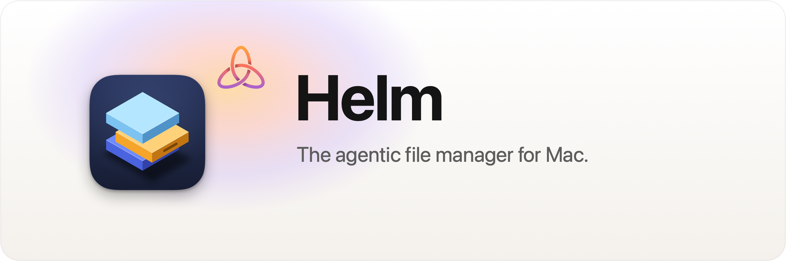
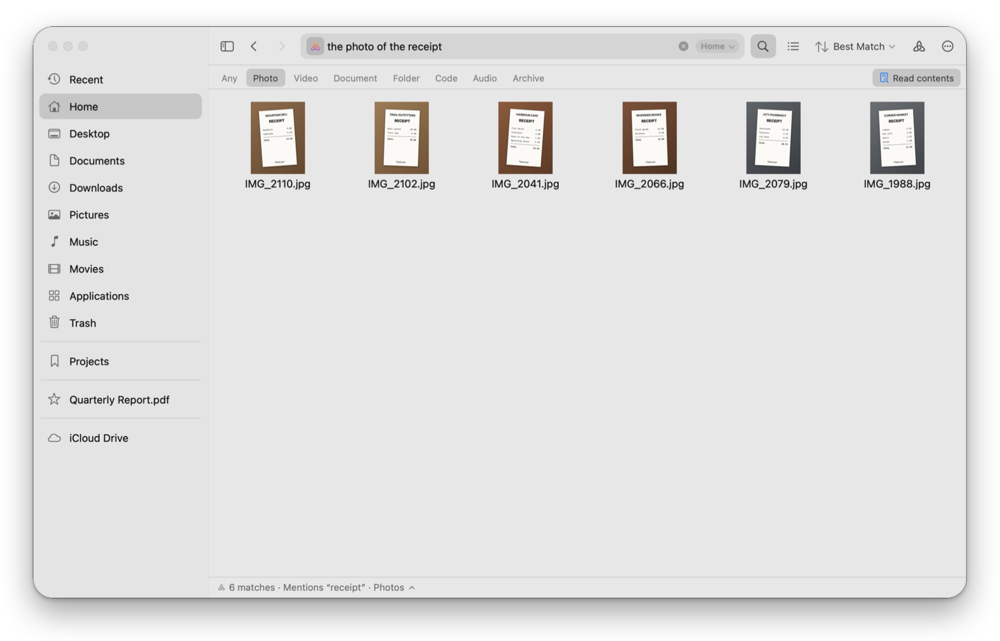
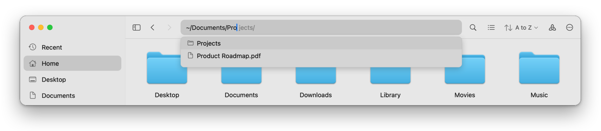
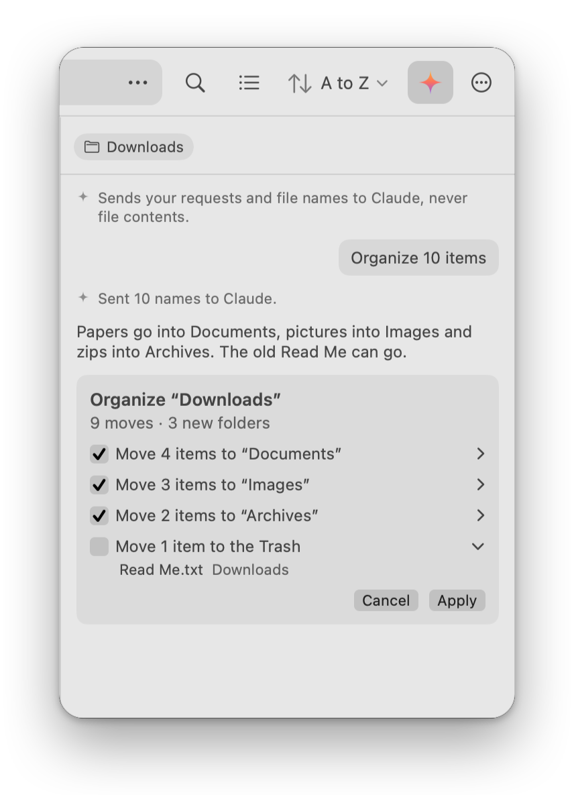
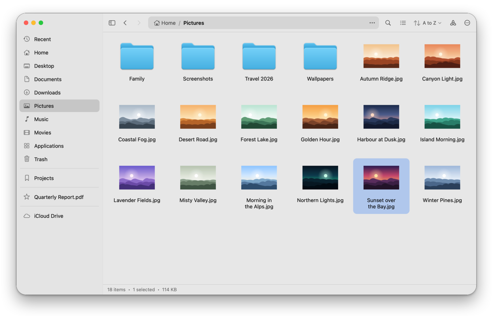

<picture>
  <source media="(prefers-color-scheme: dark)" srcset="docs/brand/banner-dark.png">
  
</picture>

**The agentic file manager for your Mac.**

Describe a file and Helm finds it. Say how a folder should look and Helm sorts it. Type a path and you're there.

**[Download Helm](https://github.com/HuseynAkh/Helm/releases/latest)** &nbsp;·&nbsp; macOS 14 or later &nbsp;·&nbsp; Apple silicon and Intel &nbsp;·&nbsp; Version 0.2, an early preview

<picture>
  <source media="(prefers-color-scheme: dark)" srcset="docs/images/ai-search-dark.png">
  
</picture>

## Find any file by describing it

Search the way you remember things: "a receipt from somewhere I ate", "the lease that renews in January", "a video of the storm". Helm turns your words into searches, runs them on your Mac, and shows what matched and why.

- **It looks inside.** Turn on **Read contents** and Helm reads documents and looks at photos and video frames, so a file turns up by what it shows, whatever it's called.
- **One kind at a time.** Photo, Video, Document, Folder, Code, Audio or Archive, one click under the search field.
- **Your model.** Your ChatGPT plan, Claude, Gemini or Grok, or a model that runs on your Mac with LM Studio or Ollama.

## Go anywhere by typing

Press **⌘L** and the path bar becomes a prompt. Type a path as you would after `cd`, and Tab completes it, folder by folder.

<picture>
  <source media="(prefers-color-scheme: dark)" srcset="docs/images/path-dark.png">
  
</picture>

| Type or press | What happens |
|---|---|
| `~`, `..`, `Documents/Pro` | Your home folder, the folder above, or a path from the folder on show |
| Tab or → | Takes the suggestion; a folder's contents are suggested at once, so Tab, Tab walks down the tree |
| Return | Goes there. A file's path opens its folder with the file selected |
| `smb://`, `afp://`, `ftp://` … | Connects to the server, as Finder's Connect to Server does |

## Tidy a folder with one sentence

Open the AI panel with **⌃⌘I** and say what you want: "organize this folder", "move the PDFs into Papers", "write a packing list in a new Trip folder". Helm shows the plan first, every folder it will make and every file it will move, copy, rename or write. Press **Apply**, and one Undo puts it all back.

  <picture><source media="(prefers-color-scheme: dark)" srcset="docs/images/ai-plan-dark.png"></picture>
  <picture><source media="(prefers-color-scheme: dark)" srcset="docs/images/ai-undo-dark.png"></picture>

It works in the folder on show or across your whole Mac, including iCloud Drive, cloud folders, servers and external disks, and with Read contents on it can file a scan by what it says and a photo by what it shows. [More about AI mode](docs/AI_MODE.md).

## A file manager that stays out of your way

Everything works without AI, and AI mode is off until you turn it on.

<picture>
  <source media="(prefers-color-scheme: dark)" srcset="docs/images/hero-dark.png">
  
</picture>

- **A sidebar that's yours.** Recent, Starred, your bookmarks, disks and cloud drives. Drag rows into your order and hide the ones you don't use.
- **Grid and list in one button.** Folders open in place in the list, and tabs and windows come back after a relaunch.
- **Search that lets go.** ⌘F looks in the folder or across the Mac, by name and inside files, and a click on your files puts the keys back.
- **Properties, as in Nautilus.** Live folder sizes, and permissions you can change on your own files, with Undo.
- **Open in Terminal** on any folder, in Ghostty, iTerm, Warp, WezTerm, kitty or Terminal.
- **Finder underneath.** The real Trash with Put Back, Quick Look, Open With, Services and Finder's drag-and-drop rules. Helm can open in place of Finder, too.

## Private by design

Helm has no servers, accounts or analytics. AI mode talks only to the provider you pick, straight from your Mac, and nothing changes until you press Apply. With LM Studio or Ollama, nothing leaves your Mac at all. [What's sent, and when](docs/PRIVACY.md).

## Install

1. [Download](https://github.com/HuseynAkh/Helm/releases/latest) `Helm-<version>.dmg` and drag Helm to Applications.
2. Open it. Helm isn't notarized yet, so macOS stops it the first time: click **Done**, then **Open Anyway** in System Settings › Privacy & Security. On macOS 14, Control-click Helm and choose **Open**.
3. Setup takes you through Full Disk Access, making Helm your file viewer, and AI mode.

Checking the download, building from source, Full Disk Access and the default file viewer: [Installing Helm](docs/INSTALL.md).

## More

- [AI mode](docs/AI_MODE.md): providers, plans, Read contents and AI search in full
- [Privacy](docs/PRIVACY.md): what is sent, where, and what Helm keeps on your Mac
- [Keyboard shortcuts](docs/SHORTCUTS.md)
- [Building, testing and contributing](CONTRIBUTING.md)
- [Finder underneath, Nautilus on top](docs/rebuild/03-finder-nautilus-balance.md): the rule Helm is built to

**Coming next:** downloading cloud files for a plan when you ask, copy progress with time left, column and gallery views with a preview pane, and smart folders.

No license has been chosen yet.
