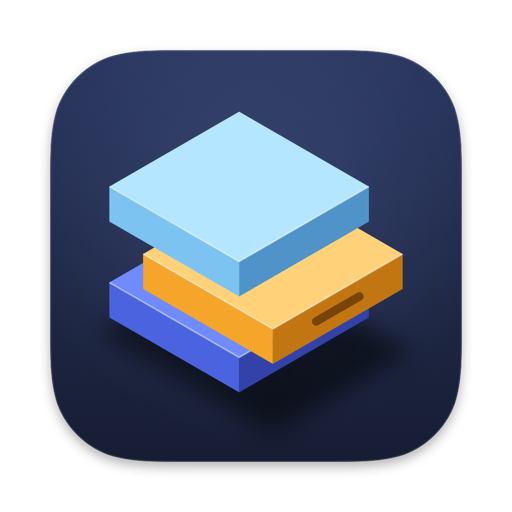
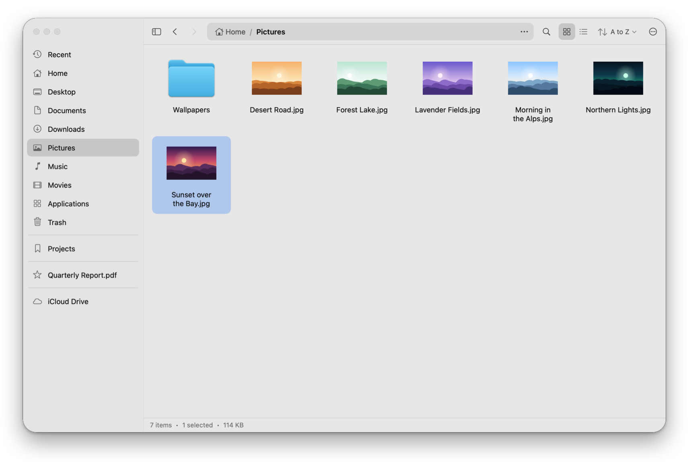
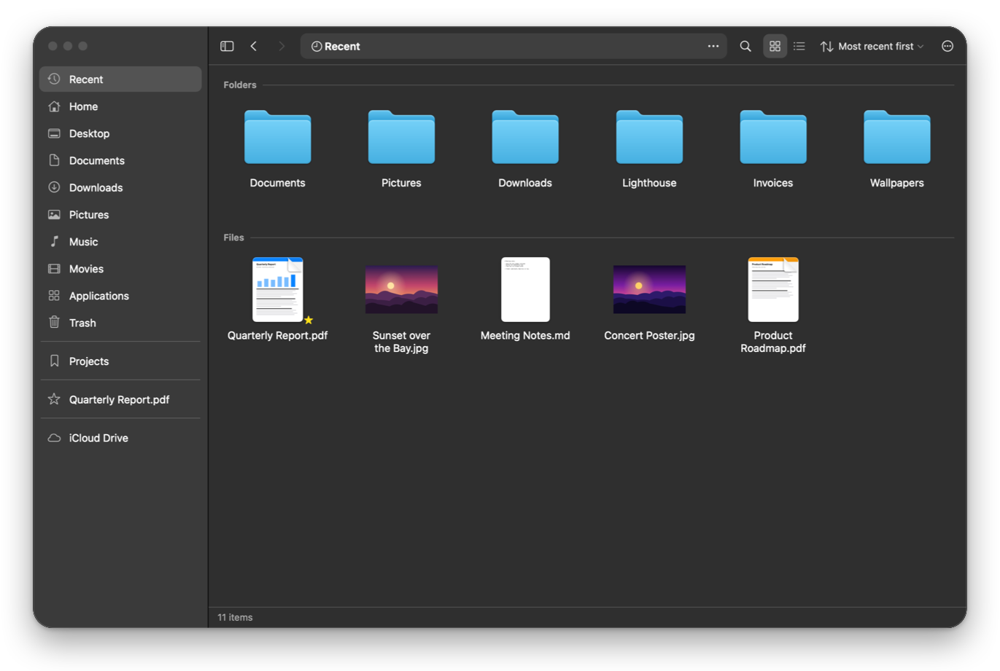
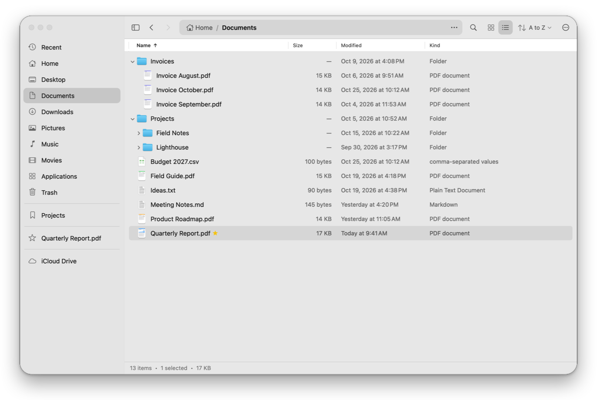
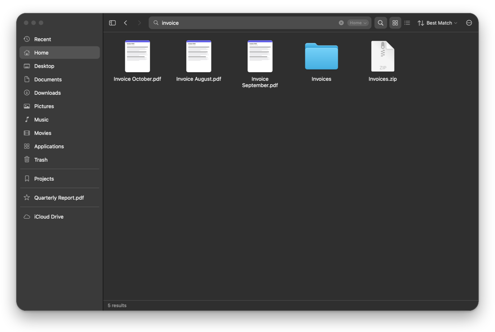
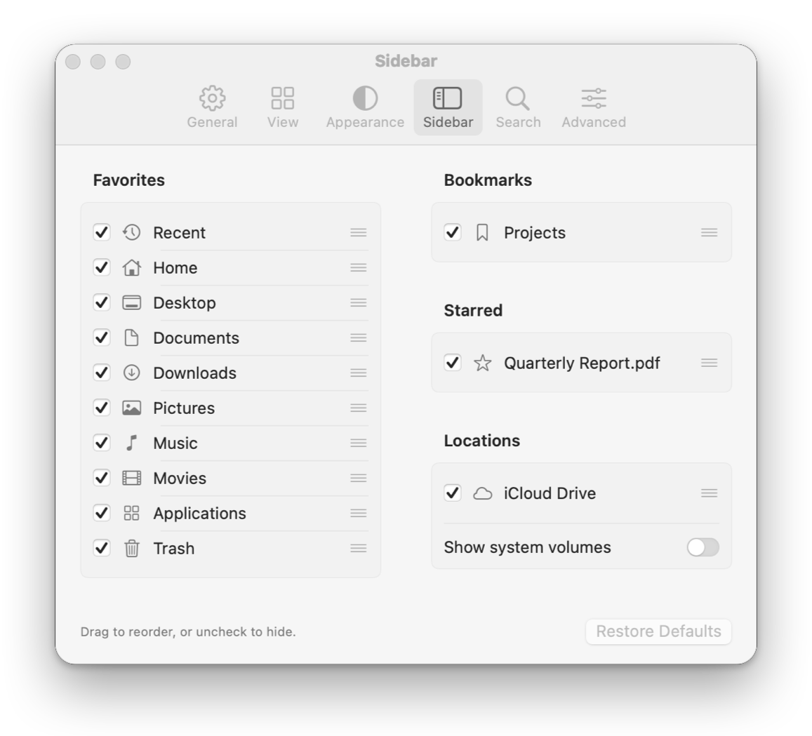
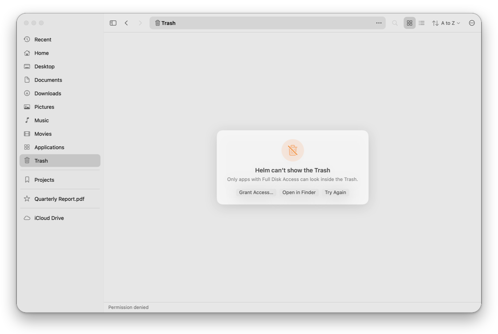
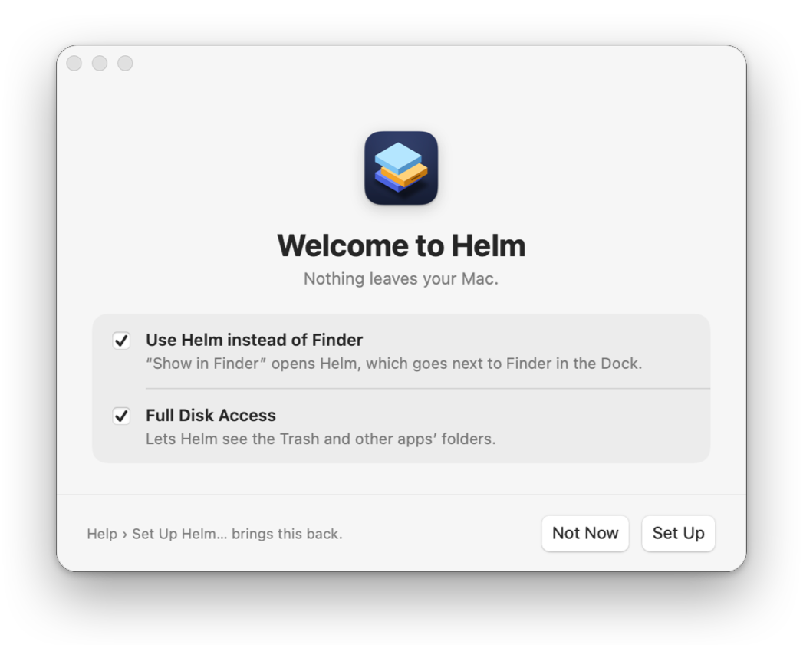
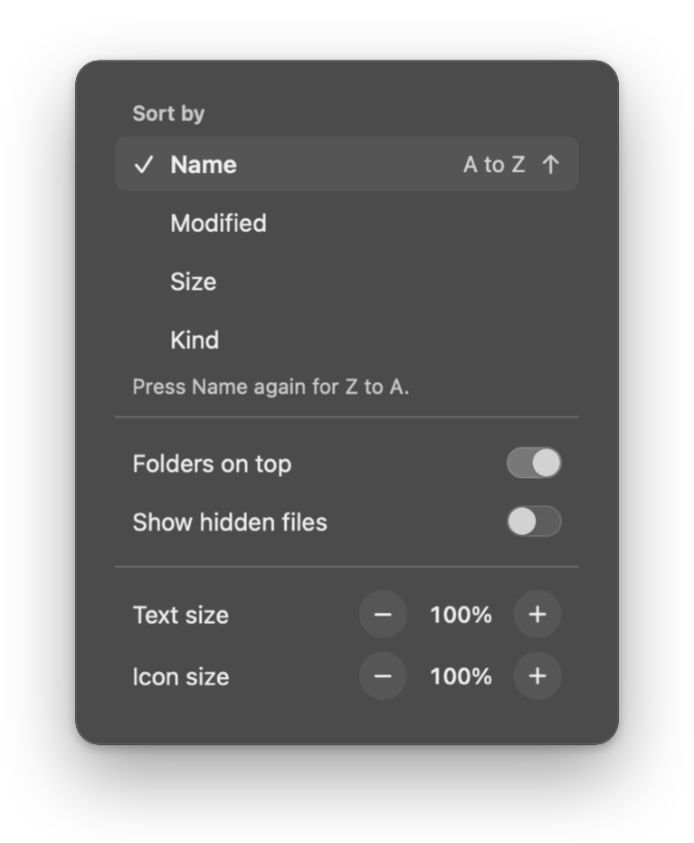

<div align="center">



# Helm

**A calm, fast file manager for macOS.**<br>
Finder underneath, Nautilus on top.


[Highlights](#highlights) · [Install](#install) · [File viewer](#make-helm-your-file-viewer) · [Full Disk Access](#full-disk-access) · [Shortcuts](#keyboard-shortcuts) · [Build and test](#build-and-test) · [Roadmap](#roadmap)

</div>

<picture>
  <source media="(prefers-color-scheme: dark)" srcset="docs/images/hero-dark.png">
  
</picture>

## Why Helm

Finder can do almost anything, but it's busy. GNOME Files, also called Nautilus, is calm: one window, a path you can type, a flat sidebar and two views. Helm brings that calm to the Mac without giving up what makes Finder trustworthy.

**What happens to your files follows macOS. How Helm looks, and how you get around, follow Nautilus.**

| Finder underneath | Nautilus on top |
|---|---|
| Copies keep dates, extended attributes, permissions and clones | One window with tabs, and a path bar you can type into |
| The real Trash, with Put Back | A flat sidebar with Recent, Starred and your bookmarks |
| Quick Look, Open With, Services and Spotlight | Grid and list, with folders that open in place |
| Finder's drag and drop rules, spring-loaded folders included | A flat header bar that says what it's doing |

## Highlights

### Recent, sorted out

Recent shows what you opened last, newest first. Folders and files get sections of their own, so the folder you were just in never buries the file you want.



### Lists that open in place

In the list, a folder unfolds right where it is, with a short, smooth animation, and stays open while you work.



### Search that lets go

Press ⌘F and type. Helm looks in the folder you're in, or across the whole Mac, matching names first and then what's inside files. Click anywhere else and the keys go back to your files: an empty search closes, and one with words keeps its results until you go somewhere else. Each tab keeps its own search.



### Your sidebar, your way

Drag sidebar rows into the order you like, and drag out the ones you don't use. Settings › Sidebar lists every row, with a checkbox to bring back anything you hid and a button to restore the defaults.

<p align="center"></p>

### Straight answers about access

macOS guards some places, such as the Trash and other apps' data. When Helm can't open one, it says why and offers a way forward: grant access, open it in Finder, or try again. The first time you open Helm, one setup screen offers to make Helm your file manager and to turn on Full Disk Access.

<p align="center">
  
  
</p>

### A header that tells you what it's doing

Grid or list is one switch. The sort button names the order, such as "A to Z" or "Newest first", and opens the view options: sort, folders on top, hidden files, and text and icon size.

<p align="center"></p>

## Everything else

- **Getting around.** Tabs and windows that come back after a relaunch. Back, Forward and Enclosing Folder. Typed paths with `~`, file URLs and any capitalisation; a typed file opens its folder with the file selected.
- **Working with files.** Copy, cut and paste, move, rename, duplicate, aliases and symbolic links. Undo and Redo. When an item fails, choose Skip, Try Again or Stop instead of losing the whole copy. Compress, Expand Archive, Move to Trash, Put Back and Empty Trash.
- **Seeing files.** Thumbnails for pictures, PDFs, films and documents, made at your screen's real resolution. Quick Look with Space. Open With lists the apps that suit a file best first, and Change Default App sets which app opens that kind of file, as Finder's Get Info does.
- **Drag and drop.** Option copies, Command moves, and both make an alias, as in Finder. Hold a drag over a folder, sidebar row, path segment or tab and it springs open. Pictures from Photos and attachments from Mail drop straight in.
- **Fitting in.** Show in Helm and Open in Helm in the Services menu. Helm can be the app that "Show in Finder" opens, and can sit next to Finder in the Dock. Light and dark appearance, adjustable transparency, and text from 80% to 170%.

## Privacy

Helm never connects to the internet. It has no accounts, analytics, crash reporting or update checks, and it doesn't read your name, your Mac's name or its serial number. It reads each disk's ID only to list the disk once, and never keeps or sends it. Files leave your Mac only when you send them: Share, AirDrop, Connect to Server, Open With, Services, drag and drop, the clipboard, or by putting them in iCloud Drive, a cloud provider's folder or a server.

What Helm keeps stays on your Mac, in `~/Library/Application Support/Helm`:

| File | What it holds |
|---|---|
| `recent.json` | Folders and files you opened, for Recent. Settings › General › **Remember recent items** turns it off, and **Go › Clear Recent** empties it. |
| `open-with.json` | Apps you've used for each kind of file, for Open With. Clear Recent empties it too. |
| `session.json` | Your windows and tabs, only while **Reopen windows and tabs** is on. |
| `bookmarks.json`, `stars.json`, `sidebar.json`, `tag-catalog.json` | Your sidebar and tags. A star or bookmark you remove leaves nothing in them. |
| `view-options.json` | Views you set for particular folders. |
| `trash-origins.json` | Where trashed items came from, for Put Back. A record goes when its item leaves the Trash through Helm, or at Helm's next launch once it sees the item is gone. Without Full Disk Access Helm can't look in the Trash, so a Trash emptied in Finder leaves its records, up to 1,000. |

Settings live in `~/Library/Preferences/com.helm.filemanager.dev.plist`. To remove everything, first click **Restore Finder** in Settings › General and turn off **Show next to Finder in the Dock** and **Open at login**. Then quit Helm and delete that file and the folder above.

Checks keep it this way. `scripts/privacy_check.py` reads the source and fails if network, tracking or identifier code appears; the release script and workflow run it before they build. Every release then passes `scripts/release/check_binary_privacy.sh`, which checks the built app's libraries, its network and identifier calls, web addresses, paths from the build machine, Info.plist and signature. Smoke runs block Helm's networking by default, so any try at it fails the run.

## Install

Helm is an early preview for macOS 14 Sonoma or later, on Apple silicon or Intel. It's developed and tested on macOS 26 Tahoe.

1. **Download** `Helm-<version>.dmg` from the [latest release](https://github.com/HuseynAkh/Helm/releases/latest). A `.zip` of the same app is there too.
2. **Verify it**, if you like. Download `SHA256SUMS.txt` from the same release, then in Terminal:

   ```bash
   cd ~/Downloads
   shasum -a 256 -c SHA256SUMS.txt --ignore-missing
   gh attestation verify Helm-<version>.dmg --repo HuseynAkh/Helm
   ```

   The first command checks the file matches the release: it prints `OK` after the file's name. The second checks that GitHub Actions built it from this repository. It needs the [GitHub CLI](https://cli.github.com), signed in with `gh auth login`. [RELEASING.md](docs/RELEASING.md#verify-a-release) explains both.
3. **Drag Helm to Applications.** Open the disk image and drag Helm onto the Applications folder beside it, then eject the disk image.
4. **Open it the first time.** Helm isn't notarized yet, so macOS stops it once. On macOS 15 and later, click **Done**, open **System Settings › Privacy & Security**, scroll to **Security**, click **Open Anyway** next to the note about Helm, and confirm with your password. On macOS 14, Control-click Helm in Applications, choose **Open**, then **Open** again. [Why it isn't notarized](docs/RELEASING.md#why-helm-isnt-notarized-yet).
5. **Set it up.** Helm opens one setup screen. Leave **Use Helm instead of Finder** and **Full Disk Access** checked and click **Set Up**, or click **Not Now** to change nothing. Opened from the disk image, Helm offers to move itself to Applications first. **Help › Set Up Helm…** brings the screen back.

Helm is signed ad hoc, so macOS treats each new version as a new app. After an update, open it as in step 4 again, and turn Full Disk Access back on: remove Helm from the list with − and add it back with +.

### Build from source

You need Xcode 27, which runs on macOS 26.6 or later, and [XcodeGen](https://github.com/yonaskolb/XcodeGen).

```bash
git clone https://github.com/HuseynAkh/Helm.git
cd Helm
bash scripts/release/make_release.sh
```

The disk image, zip and checksums land in `dist/`. Install from the disk image as above; a copy you build yourself isn't quarantined, so macOS doesn't stop it. To try Helm without building the app, `swift run HelmDev` starts it straight from the package. The Services, the default file viewer and the Dock settings need the built app.

## Make Helm your file viewer

The setup screen's **Use Helm instead of Finder** does this, and puts Helm next to Finder in the Dock. To undo it, click **Restore Finder** in Settings › General › Default File Viewer and turn off **Show next to Finder in the Dock**; **Make Default** and that Dock switch do it again. From Terminal:

```bash
/Applications/Helm.app/Contents/MacOS/Helm --default-viewer helm
/Applications/Helm.app/Contents/MacOS/Helm --dock-first on
/Applications/Helm.app/Contents/MacOS/Helm --viewer-status
```

`--default-viewer finder` and `--dock-first off` undo the first two, and `--viewer-status` says where each stands.

After that, "Show in Finder" and "Reveal in Finder" in other apps open Helm with the file selected. Some things stay with Finder whatever you choose:

- The desktop and the Dock's Finder icon.
- Folders opened from Spotlight, Dock stacks or `open`: macOS 26 doesn't let apps take over folders.
- Apps that ask Finder by name, and apps that were already open when you switched.

The details are in [DEFAULT_FILE_MANAGER.md](docs/handoff/DEFAULT_FILE_MANAGER.md).

## Full Disk Access

Helm is a file manager, so it works best when it can see your whole Mac. Without Full Disk Access, macOS keeps the Trash, Mail, Safari and other apps' data out of reach, and asks before Helm opens Desktop, Documents and Downloads. Your music, TV and photo libraries and cloud drives have switches of their own, even with Full Disk Access.

1. Check **Full Disk Access** in the setup screen and click **Set Up**, or open **Help › Full Disk Access…**.
2. Click **+** and choose Helm, or drag Helm's icon from the guide into the list.
3. Turn Helm on, then choose **Quit & Reopen** when macOS offers it.

Full Disk Access isn't part of Files and Folders: it has its own entry in Privacy & Security.

## Keyboard shortcuts

| Action | Keys | Action | Keys |
|---|---|---|---|
| New Window | ⌘N | Back / Forward | ⌘[ / ⌘] |
| New Tab | ⌘T | Enclosing Folder | ⌘↑ |
| Close Tab | ⌘W | Open | ⌘↓ or ⌘O |
| Reopen Closed Tab | ⇧⌘T | Go to Folder (type a path) | ⌘L |
| Next / Previous Tab | ⇧⌘] / ⇧⌘[ | Home | ⇧⌘H |
| Find | ⌘F | Recent | ⇧⌘F |
| Grid / List | ⌘1 / ⌘2 | Desktop / Documents | ⇧⌘D / ⇧⌘O |
| View Options | ⌘J | Downloads | ⌥⌘L |
| Show Hidden Files | ⌘. | Quick Look | Space |
| Toggle Sidebar | ⌃⌘S | Rename | Return |
| New Folder | ⇧⌘N | Move to Trash | ⌘⌫ |
| Copy as Pathname | ⌥⌘C | Empty Trash | ⇧⌘⌫ |
| Move Items Here | ⌥⌘V | Toggle Star | ⌘D |

## Build and test

Helm is a Swift package with an Xcode app target around it.

```bash
swift build
swift test
bash scripts/static_checks.sh
bash scripts/rebuild/host_smoke.sh
```

`swift test` runs the unit tests for every module, `static_checks.sh` checks project rules the compiler can't, and `host_smoke.sh` drives the real window through more than a thousand checks.

The smoke run works on a throwaway home folder it creates under `.build`, with a private pasteboard and a stand-in Trash, so it never touches your files. The pictures in this README come from a made-up home folder too: `bash scripts/readme/make_readme_images.sh` takes them again.

| Module | What it does |
|---|---|
| `HelmCore` | Tabs, navigation, selection, sorting and commands, with no AppKit |
| `HelmFileSystem` | Reading folders and metadata, watching for changes, Recent |
| `HelmOperations` | Copy, move, rename, Trash and undo |
| `HelmSearch` | Name and Spotlight search |
| `HelmPersistence` | Settings, sessions, view options, bookmarks and the sidebar's layout |
| `HelmUI` | Windows, the header, sidebar, grid, list, settings, the welcome and the default viewer switch |
| `HelmApp` | The app itself: launch, menus, access and the smoke driver |
| `HelmTestKit` | In-memory stand-ins that the tests share |
| `App/` | The Xcode app target, made with XcodeGen |

How Helm decides between Finder and Nautilus is written down in [Finder underneath, Nautilus on top](docs/rebuild/03-finder-nautilus-balance.md). The original prototype is kept in `Helm/` for reference.

## Roadmap

- Copy progress with sizes and time left.
- Selection and scroll position after a relaunch.
- More list columns: Date Created, Date Added, Tags, and folder sizes.
- Get Info with live folder sizes, and disk capacity and format.
- Moving tabs between windows.
- Network locations and AirDrop.
- Smart folders and search filters.
- Finder tags.
- iCloud download and remove-download.
- Column and gallery views, a preview pane, and printing.

## Contributing

Issues and pull requests are welcome. Before sending a change, run the tests, the static checks and the smoke run, and keep to the rule above: what happens to files follows macOS, and how Helm looks follows Nautilus.

## License

No license has been chosen yet.

---

<p align="center">
  Engineered with <a href="https://claude.ai/code">Claude Code</a> (Opus 4.6) and <a href="https://chatgpt.com">Codex</a> (5.3)
</p>
