<div align="center">

<picture>
  <source media="(prefers-color-scheme: dark)" srcset="docs/brand/banner-dark.png">
  
</picture>

# Helm

**Helm is an agentic file manager for macOS.**<br>
Ask it to organize, move and find your files. Nothing changes until you press Apply.


[AI mode](#ai-mode) · [How it works](#how-it-works) · [Privacy](#privacy) · [Install](#install) · [The file manager](#the-file-manager) · [Shortcuts](#keyboard-shortcuts) · [Build and test](#build-and-test)

</div>

<picture>
  <source media="(prefers-color-scheme: dark)" srcset="docs/images/ai-panel-dark.png">
  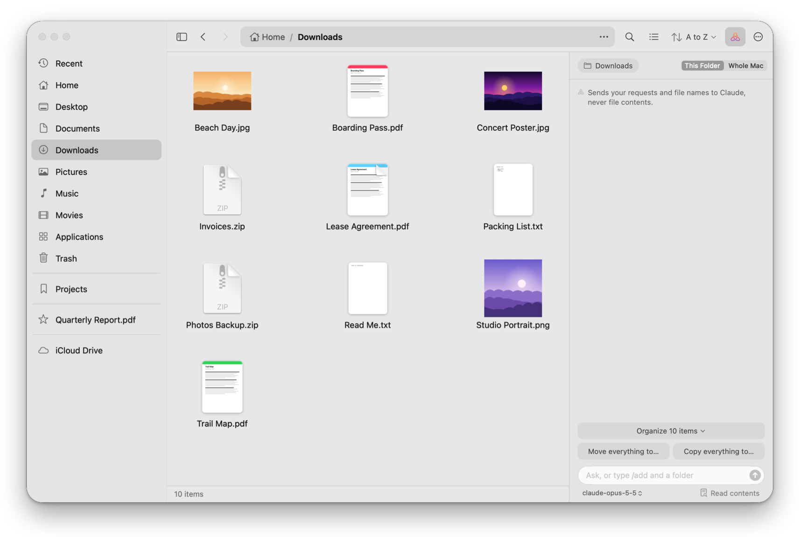
</picture>

## AI mode

### Press the spark

The spark at the top right opens the AI panel beside your files. It works in the folder on show, and offers three things to do there: organize it, move everything, or copy everything. Or type what you want, such as "move the PDFs into Papers".

### Plan, then Apply

Helm shows the plan before anything happens: each group of changes, with a tick and its full list. Moving to the Trash, and anything that lands where others can see it, starts unticked. Press Apply, and one Undo puts it all back.

<p align="center">
  
  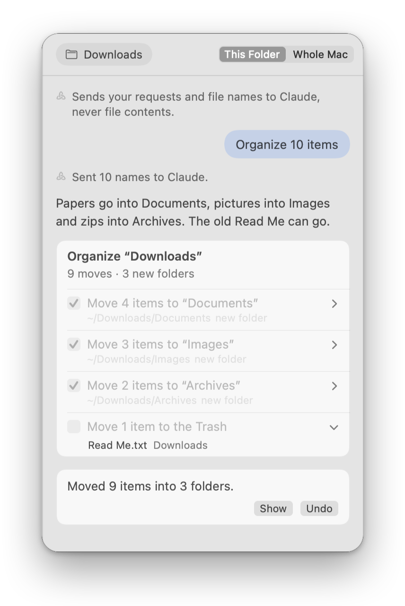
</p>

### Find with AI

Turn on the spark in the search field and describe the file. The model plans the searches, Helm runs them on your Mac, and the status bar says how it read your words. Point at a result to see why it matched.

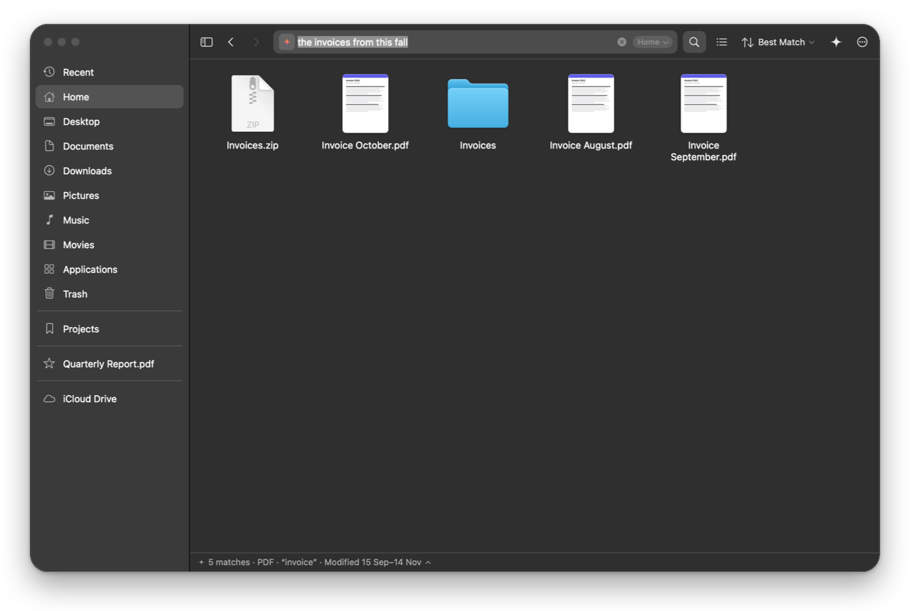

## How it works

- **AI mode** is a model that works on your files through Helm. It lists folders and proposes changes. Helm checks every change, and only Helm touches the disk.
- **Bring your own model.** OpenAI with your ChatGPT plan: click **Continue with ChatGPT**, with no key to paste. Claude, Gemini and Grok with your key. Ollama and LM Studio on your Mac. Or any OpenAI-compatible API, by its https address.
- **Only the folders you give it.** The folder on show, plus any you add: type `/add` and a folder, type or drop a path, or drop a folder on the panel. `/clear` starts over and forgets them.
- **Remote and cloud folders.** iCloud Drive, Google Drive, Dropbox, OneDrive, servers and external disks work too. The folder's chip says where it is, and the plan says when changes will sync or reach other people. Helm never downloads files to do it.
- **Nothing changes until you press Apply.** Changes run through Helm's own file operations, so conflicts keep both files, removals go to the Trash, and one Undo puts everything back.

AI mode is off until you turn it on. The AI Mode screen appears after setup, and Settings › AI holds the same choices. Beside each provider, the ⓘ button says in one line what it uses and what it costs, and **How to connect** opens the provider's own page in your browser.

| Provider | How to connect |
|---|---|
| OpenAI | Click **Continue with ChatGPT** and sign in in your browser. Your ChatGPT plan pays for the requests. **Use an API key instead** takes a key from [OpenAI's platform](https://developers.openai.com/api/docs/quickstart) |
| Claude | Paste an API key from the [Claude Console](https://platform.claude.com/docs/en/manage-claude/authentication#api-keys). Anthropic requires a key for apps like Helm and doesn't allow them to use a Claude plan |
| Gemini | Paste an API key from [Google AI Studio](https://aistudio.google.com/docs/api-key) |
| Grok | Paste an API key made as [xAI's quickstart](https://docs.x.ai/docs/quickstart) shows |
| Ollama | Open [Ollama](https://docs.ollama.com/quickstart) and download a model. Helm finds it on this Mac |
| LM Studio | Turn on LM Studio's [local server](https://lmstudio.ai/docs/developer/core/server) and load a model. **Refresh Models** in Settings › AI picks up one loaded later |
| Other | Type the service's https address, and its key if it needs one |

<p align="center">
  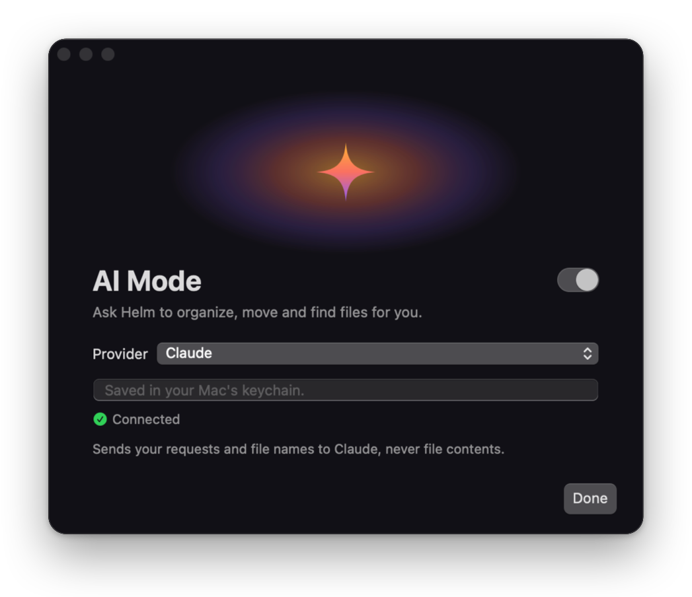
  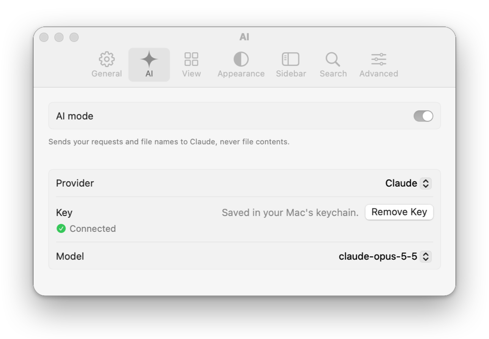
</p>

## Privacy

Helm connects only to the AI provider you choose, and only while AI mode is on. AI mode is off until you turn it on.

**What is sent.** Your requests, and the names and details of files (size, dates and kind). Never what's inside a file. The top of every thread says so, and each request says how many names it sent.

- AI search sends your words and the names of files that match. A match can come from text inside a file, found by Spotlight on this Mac. That text is never sent.
- A path you type in the middle of a message is sent as you typed it, your home folder's name included. A folder at the end of a message is added to the panel and sent only as an id.

**Where it goes.** Only to the one you picked:

| Provider | Address |
|---|---|
| Claude | `https://api.anthropic.com` |
| OpenAI | `https://api.openai.com/v1`. Signing in with ChatGPT also goes to OpenAI's sign-in host, `https://auth.openai.com`, which gets no file names |
| Gemini | `https://generativelanguage.googleapis.com/v1beta` |
| Grok | `https://api.x.ai/v1` |
| Ollama, LM Studio | Loopback, `127.0.0.1`, on this Mac. Ports 11434 and 1234 unless you change them |
| Other | The https address you type |

**Signing in with ChatGPT.** Your browser opens OpenAI's sign-in page, and comes back to Helm on this Mac: Helm listens on `127.0.0.1` for that one visit, for up to five minutes, then stops. Helm sends OpenAI a random ID for this Mac and the name Helm, never your name or your Mac's. Your email is shown in Settings › AI and is never sent to a model. The sign-in's tokens stay in your Mac's keychain, never in a file, a log or `ai.json`, and Helm renews them as they run out. **Remove** in Settings › AI signs out and asks OpenAI to revoke them; if OpenAI doesn't confirm, disconnect Helm under **Sign in with ChatGPT** in ChatGPT's settings. [OpenAI's help](https://help.openai.com/en/articles/20001542-using-your-chatgpt-plan-in-other-apps-and-sites) explains plan use in other apps, and [ChatGPT's usage page](https://chatgpt.com/settings/usage) shows what Helm used.

**Keys.** Claude requires a key: Anthropic doesn't allow apps like Helm to sign in with a Claude account or use a Claude plan. Each key is saved in your Mac's keychain, never in a file, a log or a picture. Removing the app doesn't remove keys or a sign-in: click **Remove Key** or **Remove** in Settings › AI first, or delete the items named **Helm AI key** and **Helm ChatGPT sign-in** in Keychain Access (their place is `com.helm.filemanager.ai-key`). Helm is signed ad hoc, so macOS may ask for your keychain password after an update.

Keys are made on each provider's site, as the table under [How it works](#how-it-works) shows. On Gemini's free tier, Google may use what you send to improve its products.

The help pages open in your browser. Helm itself never connects to them.

**Limits.**

- **No downloads in cloud folders.** A file that isn't downloaded is left out of any change that needs its contents, and Helm says how many.
- **Places with no Trash**, such as some servers: copies and new folders there can't be undone, and the plan says so before you press Apply.
- **Small local models** can miss files in big folders. Many load a small context by default.
- **A mirrored cloud folder with no shortcut reads as This Mac.** A sync app that keeps a plain folder in step and marks nothing, such as an older Dropbox, isn't recognized, so the plan won't say that changes sync.
- **Folders outside the home folder and the volumes** can't be used, such as `/opt` or `/usr/local`. AI mode works in your home folder, on disks under `/Volumes`, and in the Shared folder.

**Nothing is saved.** Threads, added folders and plans stay in memory. They're gone after `/clear`, when the window closes, when AI mode turns off, or when Helm quits.

Helm has no accounts, analytics, crash reporting or update checks, and it doesn't read your name, your Mac's name or its serial number. It reads each disk's ID only to list the disk once, and never keeps or sends it. Otherwise files leave your Mac only when you send them: Share, AirDrop, Connect to Server, Open With, Services, drag and drop, the clipboard, or by putting them in iCloud Drive, a cloud provider's folder or a server.

What Helm keeps stays on your Mac, in `~/Library/Application Support/Helm`:

| File | What it holds |
|---|---|
| `recent.json` | Folders and files you opened, for Recent. Settings › General › **Remember recent items** turns it off, and **Go › Clear Recent** empties it. |
| `open-with.json` | Apps you've used for each kind of file, for Open With. Clear Recent empties it too. |
| `session.json` | Your windows and tabs, only while **Reopen windows and tabs** is on. |
| `bookmarks.json`, `stars.json`, `sidebar.json`, `tag-catalog.json` | Your sidebar and tags. A star or bookmark you remove leaves nothing in them. |
| `view-options.json` | Views you set for particular folders. |
| `ai.json` | AI mode's provider, models, ports, the address you typed for Other, whether OpenAI uses a key in place of your ChatGPT sign-in, and which build of Helm saved each key. Never a key, a token, a folder or a conversation. |
| `trash-origins.json` | Where trashed items came from, for Put Back. A record goes when its item leaves the Trash through Helm, or at Helm's next launch once it sees the item is gone. Without Full Disk Access Helm can't look in the Trash, so a Trash emptied in Finder leaves its records, up to 1,000. |

Settings live in `~/Library/Preferences/com.helm.filemanager.dev.plist`. To remove everything, first click **Restore Finder** in Settings › General and turn off **Show next to Finder in the Dock** and **Open at login**. Click **Remove Key**, or **Remove** for a ChatGPT sign-in, in Settings › AI. Then quit Helm and delete that file and the folder above.

Checks keep it this way. `scripts/privacy_check.py` reads the source and fails if network code appears outside AI mode's one transport file, if a socket appears outside the one file that listens on `127.0.0.1` for a ChatGPT sign-in, if a web address appears that isn't one of the providers', OpenAI's sign-in host or the listed help pages, or if tracking or identifier code appears; the release script and workflow run it before they build. Every release then passes `scripts/release/check_binary_privacy.sh`, which checks the built app's libraries, its network and identifier calls (it may listen, never connect a socket), web addresses, paths from the build machine, Info.plist and signature. Smoke runs block Helm's networking, so any try at it fails the run, and one run turns AI mode on with the shipped code to prove the block bites.

## Install

Helm is an early preview for macOS 14 Sonoma or later, on Apple silicon or Intel. It's developed and tested on macOS 26 Tahoe.

1. **Download** `Helm-<version>.dmg` from the [latest release](https://github.com/HuseynAkh/Helm/releases/latest). A `.zip` of the same app is there too.
2. **Verify it**, if you like. Download `SHA256SUMS.txt` from the same release, then in Terminal:

   ```bash
   cd ~/Downloads
   shasum -a 256 -c SHA256SUMS.txt --ignore-missing
   gh attestation verify Helm-<version>.dmg --repo HuseynAkh/Helm
   ```

   The first command checks the file matches the release: it prints `OK` after the file's name. The second checks that GitHub Actions built it from this repository. It needs the [GitHub CLI](https://cli.github.com), signed in with `gh auth login`. [RELEASING.md](docs/RELEASING.md#verify-a-release) explains both.
3. **Drag Helm to Applications.** Open the disk image and drag Helm onto the Applications folder beside it, then eject the disk image.
4. **Open it the first time.** Helm isn't notarized yet, so macOS stops it once. On macOS 15 and later, click **Done**, open **System Settings › Privacy & Security**, scroll to **Security**, click **Open Anyway** next to the note about Helm, and confirm with your password. On macOS 14, Control-click Helm in Applications, choose **Open**, then **Open** again. [Why it isn't notarized](docs/RELEASING.md#why-helm-isnt-notarized-yet).
5. **Set it up.** Helm opens one setup screen. Leave **Use Helm instead of Finder** and **Full Disk Access** checked and click **Set Up**, or click **Not Now** to change nothing. Opened from the disk image, Helm offers to move itself to Applications first. **Help › Set Up Helm…** brings the screen back.
6. **Turn on AI mode**, if you want it. The AI Mode screen comes next: switch it on, pick a provider, then click **Continue with ChatGPT** for OpenAI, paste your key, or start Ollama or LM Studio, and click **Done**. The panel opens. Close the screen any other way and AI mode stays off.

Helm is signed ad hoc, so macOS treats each new version as a new app. After an update, open it as in step 4 again, and turn Full Disk Access back on: remove Helm from the list with − and add it back with +.

### Build from source

You need Xcode 27, which runs on macOS 26.6 or later, and [XcodeGen](https://github.com/yonaskolb/XcodeGen).

```bash
git clone https://github.com/HuseynAkh/Helm.git
cd Helm
bash scripts/release/make_release.sh
```

The disk image, zip and checksums land in `dist/`. Install from the disk image as above; a copy you build yourself isn't quarantined, so macOS doesn't stop it. To try Helm without building the app, `swift run HelmDev` starts it straight from the package. The Services, the default file viewer and the Dock settings need the built app.

## The file manager

Underneath AI mode is a calm, fast file manager. Everything works without AI mode, and it starts off.

<picture>
  <source media="(prefers-color-scheme: dark)" srcset="docs/images/hero-dark.png">
  
</picture>

### Grid and List in one button

The header holds one button for the view: it shows the view you'd switch to, and ⌘1 and ⌘2 still pick one. The sort button names the order, such as "A to Z" or "Newest first", and opens the view options: sort, folders on top, hidden files, and text and icon size.

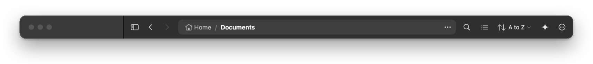

<p align="center">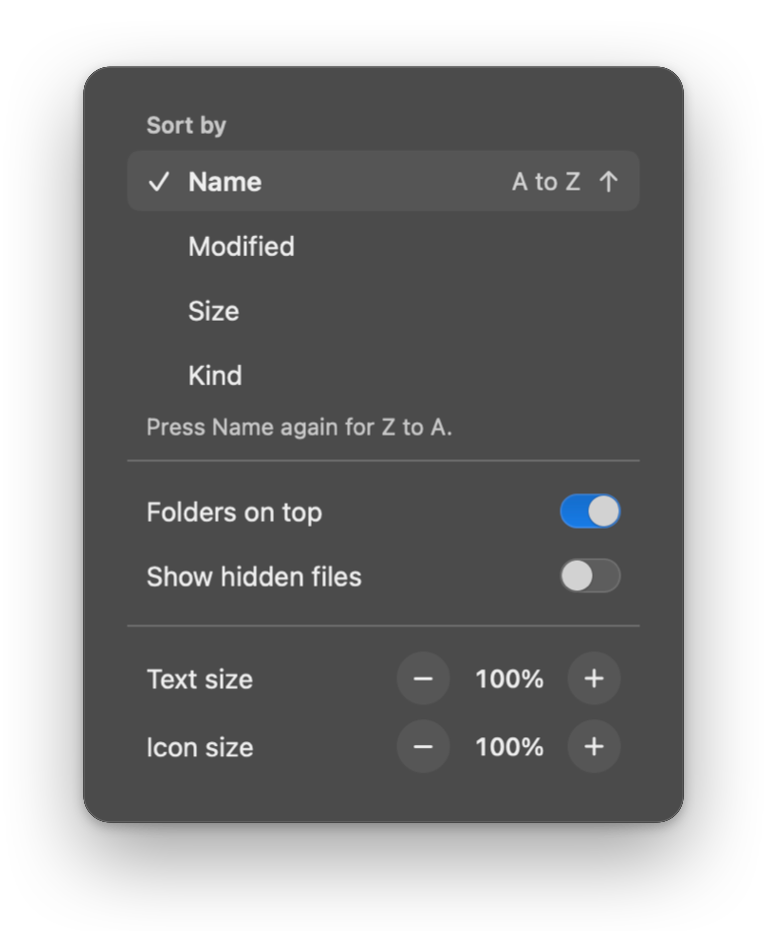</p>

### Recent, sorted out

Recent shows what you opened last, newest first. Folders and files get sections of their own, so the folder you were just in never buries the file you want.

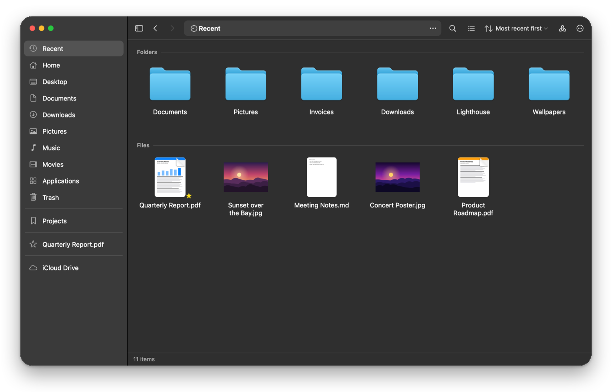

### Lists that open in place

In the list, a folder unfolds right where it is, with a short, smooth animation, and stays open while you work.

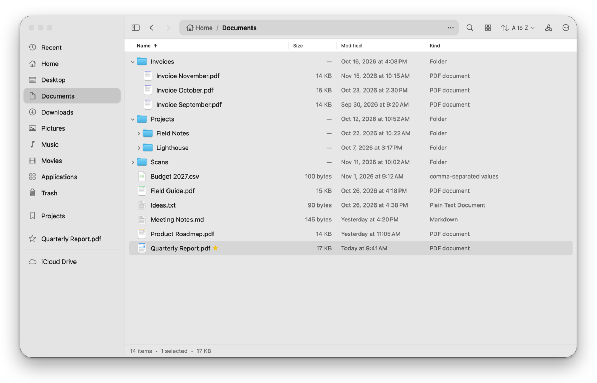

### Search that lets go

Press ⌘F and type. Helm looks in the folder you're in, or across the whole Mac, matching names first and then what's inside files. Click anywhere else and the keys go back to your files: an empty search closes, and one with words keeps its results until you go somewhere else. Each tab keeps its own search.

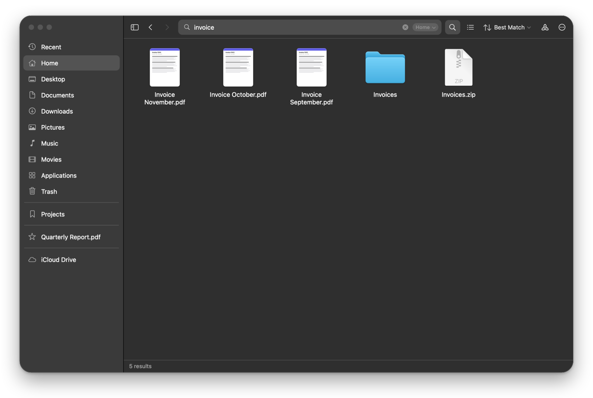

### Your sidebar, your way

Drag sidebar rows into the order you like, and drag out the ones you don't use. Settings › Sidebar lists every row, with a checkbox to bring back anything you hid and a button to restore the defaults.

<p align="center">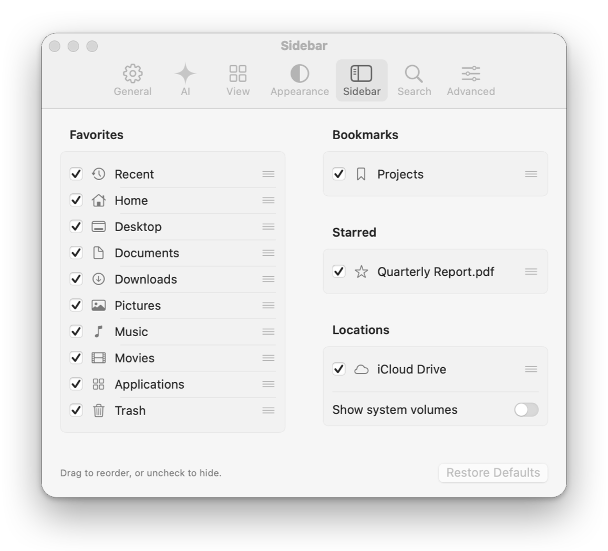</p>

### Straight answers about access

macOS guards some places, such as the Trash and other apps' data. When Helm can't open one, it says why and offers a way forward: grant access, open it in Finder, or try again. The first time you open Helm, one setup screen offers to make Helm your file manager and to turn on Full Disk Access.

<p align="center">
  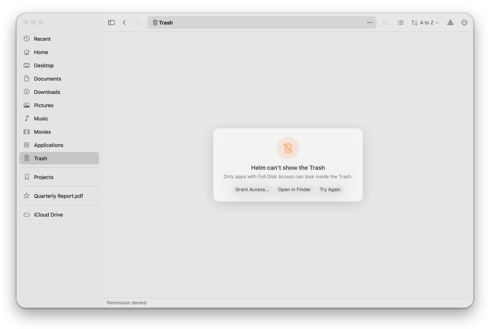
  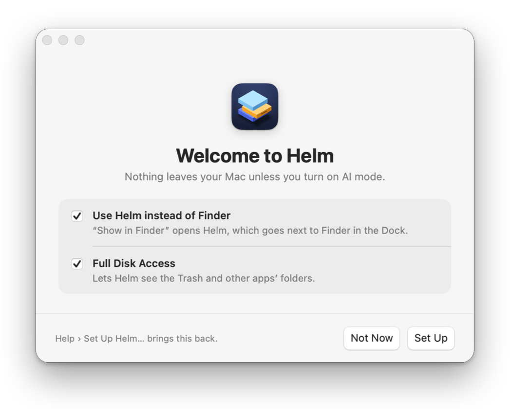
</p>

### Everything else

- **Getting around.** Tabs and windows that come back after a relaunch. Back, Forward and Enclosing Folder. Typed paths with `~`, file URLs and any capitalisation; a typed file opens its folder with the file selected.
- **Working with files.** Copy, cut and paste, move, rename, duplicate, aliases and symbolic links. Undo and Redo. When an item fails, choose Skip, Try Again or Stop instead of losing the whole copy. Compress, Expand Archive, Move to Trash, Put Back and Empty Trash.
- **Seeing files.** Thumbnails for pictures, PDFs, films and documents, made at your screen's real resolution. Quick Look with Space. Open With lists the apps that suit a file best first, and Change Default App sets which app opens that kind of file, as Finder's Get Info does.
- **Drag and drop.** Option copies, Command moves, and both make an alias, as in Finder. Hold a drag over a folder, sidebar row, path segment or tab and it springs open. Pictures from Photos and attachments from Mail drop straight in.
- **Fitting in.** Show in Helm and Open in Helm in the Services menu. Helm can be the app that "Show in Finder" opens, and can sit next to Finder in the Dock. Light and dark appearance, adjustable transparency, and text from 80% to 170%.

## Nautilus on top, Finder underneath

Helm started from GNOME Files, also called Nautilus, and that is still its DNA: one window, a path you can type, a flat sidebar and two views. Finder keeps the files honest.

**What happens to your files follows macOS. How Helm looks, and how you get around, follow Nautilus.** AI mode follows the same rule: every change it makes is an ordinary Finder-style operation.

| Finder underneath | Nautilus on top |
|---|---|
| Copies keep dates, extended attributes, permissions and clones | One window with tabs, and a path bar you can type into |
| The real Trash, with Put Back | A flat sidebar with Recent, Starred and your bookmarks |
| Quick Look, Open With, Services and Spotlight | Grid and list, with folders that open in place |
| Finder's drag and drop rules, spring-loaded folders included | A flat header bar that says what it's doing |

The whole rule is written down in [Finder underneath, Nautilus on top](docs/rebuild/03-finder-nautilus-balance.md).

## Make Helm your file viewer

The setup screen's **Use Helm instead of Finder** does this, and puts Helm next to Finder in the Dock. To undo it, click **Restore Finder** in Settings › General › Default File Viewer and turn off **Show next to Finder in the Dock**; **Make Default** and that Dock switch do it again. From Terminal:

```bash
/Applications/Helm.app/Contents/MacOS/Helm --default-viewer helm
/Applications/Helm.app/Contents/MacOS/Helm --dock-first on
/Applications/Helm.app/Contents/MacOS/Helm --viewer-status
```

`--default-viewer finder` and `--dock-first off` undo the first two, and `--viewer-status` says where each stands.

After that, "Show in Finder" and "Reveal in Finder" in other apps open Helm with the file selected. Some things stay with Finder whatever you choose:

- The desktop and the Dock's Finder icon.
- Folders opened from Spotlight, Dock stacks or `open`: macOS 26 doesn't let apps take over folders.
- Apps that ask Finder by name, and apps that were already open when you switched.

The details are in [DEFAULT_FILE_MANAGER.md](docs/handoff/DEFAULT_FILE_MANAGER.md).

## Full Disk Access

Helm is a file manager, so it works best when it can see your whole Mac. Without Full Disk Access, macOS keeps the Trash, Mail, Safari and other apps' data out of reach, and asks before Helm opens Desktop, Documents and Downloads. Your music, TV and photo libraries and cloud drives have switches of their own, even with Full Disk Access.

1. Check **Full Disk Access** in the setup screen and click **Set Up**, or open **Help › Full Disk Access…**.
2. Click **+** and choose Helm, or drag Helm's icon from the guide into the list.
3. Turn Helm on, then choose **Quit & Reopen** when macOS offers it.

Full Disk Access isn't part of Files and Folders: it has its own entry in Privacy & Security.

## Keyboard shortcuts

| Action | Keys | Action | Keys |
|---|---|---|---|
| Show AI Panel | ⌃⌘I | Find with AI | ⌥⌘F |
| New Window | ⌘N | Back / Forward | ⌘[ / ⌘] |
| New Tab | ⌘T | Enclosing Folder | ⌘↑ |
| Close Tab | ⌘W | Open | ⌘↓ or ⌘O |
| Reopen Closed Tab | ⇧⌘T | Go to Folder (type a path) | ⌘L |
| Next / Previous Tab | ⇧⌘] / ⇧⌘[ | Home | ⇧⌘H |
| Find | ⌘F | Recent | ⇧⌘F |
| Grid / List | ⌘1 / ⌘2 | Desktop / Documents | ⇧⌘D / ⇧⌘O |
| View Options | ⌘J | Downloads | ⌥⌘L |
| Show Hidden Files | ⌘. | Quick Look | Space |
| Toggle Sidebar | ⌃⌘S | Rename | Return |
| New Folder | ⇧⌘N | Move to Trash | ⌘⌫ |
| Copy as Pathname | ⌥⌘C | Empty Trash | ⇧⌘⌫ |
| Move Items Here | ⌥⌘V | Toggle Star | ⌘D |

In the AI panel, ⌘Return presses Apply and Escape stops a request or cancels a plan.

## Build and test

Helm is a Swift package with an Xcode app target around it.

```bash
swift build
swift test
bash scripts/static_checks.sh
bash scripts/rebuild/host_smoke.sh
```

`swift test` runs the unit tests for every module, `static_checks.sh` checks project rules the compiler can't, and `host_smoke.sh` drives the real window through more than a thousand checks. AI mode's steps use a scripted model, so no test needs a key or a connection.

The smoke run works on a throwaway home folder it creates under `.build`, with a private pasteboard and a stand-in Trash, so it never touches your files. The pictures in this README come from a made-up home folder and the same scripted model: `bash scripts/readme/make_readme_images.sh` takes them again and redraws the banner.

| Module | What it does |
|---|---|
| `HelmCore` | Tabs, navigation, selection, sorting and commands, with no AppKit |
| `HelmFileSystem` | Reading folders and metadata, watching for changes, Recent |
| `HelmOperations` | Copy, move, rename, Trash and undo |
| `HelmSearch` | Name and Spotlight search, and running AI search's plans |
| `HelmPersistence` | Settings, sessions, view options, bookmarks and the sidebar's layout |
| `HelmAgent` | AI mode: the providers, the one network transport, the conversation, folder rules and plan checks. It can't change or open a file |
| `HelmUI` | Windows, the header, sidebar, grid, list, the AI panel, settings, the welcome and the default viewer switch |
| `HelmApp` | The app itself: launch, menus, access and the smoke driver |
| `HelmTestKit` | In-memory stand-ins that the tests share |
| `App/` | The Xcode app target, made with XcodeGen |

The original prototype is kept in `Helm/` for reference.

## Roadmap

- Reading inside files in AI mode, when you allow it.
- Downloading cloud files for a plan, when you ask.
- Copy progress with sizes and time left.
- Selection and scroll position after a relaunch.
- More list columns: Date Created, Date Added, Tags, and folder sizes.
- Get Info with live folder sizes, and disk capacity and format.
- Moving tabs between windows.
- Network locations and AirDrop.
- Smart folders and search filters.
- Finder tags.
- iCloud download and remove-download.
- Column and gallery views, a preview pane, and printing.

## Contributing

Issues and pull requests are welcome. Before sending a change, run the tests, the static checks and the smoke run, and keep to the rule above: what happens to files follows macOS, and how Helm looks follows Nautilus.

## License

No license has been chosen yet.
